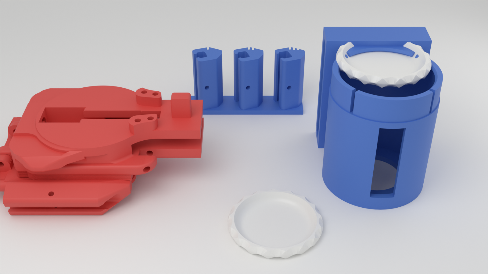

# Disc launcher upgrades

Fixes and add-ons for MechBrick's Spidey Disc Launcher MK-I (its STLs are named "DWS"). The launcher body and wrist mount become one solid piece that straps on with an Apple Watch band, and there is a belt canister for spare discs. Every part you need is here, laid out on print plates by color.



## What was breaking

The original wrist mount is two parts: a top plate (`DWS_WristMount_Body_v4`) and a C-shaped cuff (`DWS_WristMount_Brace_v2`). The cuff's curled ends hook around curled edges on the plate. Those curls are about 2 mm thick at the neck, in short segments, and they take every snap-on, pull-off and shot. That's the torn edge in the photo. The launcher body then pins onto the plate with a filament pin through two small tabs.

## Print plates

**Open `spidey_launcher_all_plates_kobra3.3mf` as a project** (Anycubic Slicer Next, OrcaSlicer or Bambu Studio). It has all six plates in one file, laid out by filament color. Print them in this order:

| Plate | Color | What's on it |
|---|---|---|
| 1 `plate1_any_color_fit_test` | any | Watch band fit coupon: three short rails with tight / middle / loose slots (1 / 2 / 3 notches on top). **Print this first.** |
| 2 `plate2_red_launcher` | red | **The main print:** launcher body and wrist plate as one part, plus the palm cap (`Link2_Cap`) and trigger pad (`Link3_Pad`). |
| 3 `plate3_black_mechanism` | black | The moving parts: slider and retainer, pushers A and B, lever, `Link3`, spring lock pin, 5 printed springs. |
| 4 `plate4_red_discs` | red | 12 discs, enough to fill the canister. |
| 5 `plate5_black_belt_canister` | black | Belt canister for 12 discs. **Measure your belt first** (see below). |
| 6 `optional_plate_only` | either | Just the new wrist plate, if you'd rather keep a separate launcher body and pin it on like before. |

If your slicer puts everything on one plate instead, use the single-plate files in `plates/` (same names). `stl/` has an STL of every part.

Want it the other way around (black launcher, red accents)? Load the other spool; nothing else changes. Hardware, same as the original: one 5.5 x 38 mm metal compression spring and 1.75 mm filament for the pins. The C-shaped printed springs on plate 3 are the launch spring; the original file had 5, likely one plus spares.

The mechanism parts and discs on plates 3 and 4 are the original designer's files, unchanged (copies are in `original/parts/`).

## What the new parts do

- **One-piece launcher:** the launcher body and wrist plate are one part, replacing `Main Body_Short`, `WristMount_Body` and `WristMount_Brace`. No curled hooks, no cuff, and the body can't come off the plate. Each side has a solid rail that takes an Apple Watch band.
- **Band slot:** open at both ends, so a 41 mm or 45 mm band should slide in either way. A small hole at the middle of each rail lines up with the band's latch; poke a paperclip in to release it.
- **Belt canister:** discs snap in past a flexible lip at the top. Push up through the hole in the bottom to pop one out. The window shows how many are left.

### How the one-piece was made

- The launcher body's end knuckles pin between the plate's two tabs (both 2.2 mm holes). Flipped end for end about that pin, the body lies along the plate with zero overlap and a 2.3 mm gap under its floor.
- The gap is filled under both sides of the body. The plate's middle channel and the pocket at its far end are left open in case moving parts use them.
- The two small windows in the body's floor, where the old cuff hooks clipped in, are filled solid.
- The pin hole is kept open, so anything that pivoted on that pin still can.

## Before printing

1. **Band fit:** print plate 1 and slide your band into each slot. Pick the one that slides in snugly and clicks. If none are right, change `FIT` in `launcher.py` (+ is looser) and rerun.
2. **Assembly order:** with the body fused to the plate, the moving parts have to go in with the body already on the plate. I checked that the body's floor has no openings parts would need to pass through from below, but check your assembly steps against it before printing.
3. **Belt size:** `BELT_W` and `BELT_T` in `launcher.py` are placeholders (38 x 4.5 mm). Measure the belt and update them.

## PETG or PLA

- **Launcher, canister, mechanism parts, discs: PETG.** It bends before it breaks, which is what this toy needs, and it's what your Kobra is already dialed in for. PLA is stiffer but snaps.
- **Springs: start with PETG, keep PLA as plan B.** The original print settings look like Bambu's PLA defaults, so the springs were probably tuned in PLA. PLA is stiffer, so PETG springs will push a bit softer (shorter shots) but last longer. If the shots feel weak, reprint just the springs in PLA.

## Print settings (Anycubic Kobra 3 V2, PETG)

- 0.4 mm nozzle, 0.12 to 0.16 mm layers
- **6 walls**, 5 top/bottom layers, 40% gyroid infill (the rails end up mostly solid)
- **Plate 2:** the launcher prints standing on its end, the way the original body printed (already turned that way in the file). Turn on tree supports, **build plate only**: the free end of the plate and the ends of the rails need a few. A 5 mm brim helps; it's 71 mm tall on a small footprint.
- **Plates 3 and 4:** the original parts in the designer's orientation; use supports if your slicer flags overhangs.
- Plates 1 and 5 and the optional plate: no supports.

## Changing the design

Everything is generated from `launcher.py`; the sizes are settings at the top.

```bash
pip install numpy trimesh manifold3d
python launcher.py
```

That rebuilds the all-plates 3MF, `plates/` and `stl/`, and fails if any part has loose pieces or hidden pockets. To re-render the picture in Blender:

```bash
blender -b -P render.py
```

`original/` holds the source files it needs: the original wrist plate, the launcher body, the mechanism parts and a disc (30.46 mm across, 3.2 mm thick).

## Credits

This is a remix of [Spidey Disc Launcher MK-I](https://makerworld.com/en/models/575061-spidey-disc-launcher-mk-i) by MechBrick (its files are the "DWS" STLs in `wrist-mounted-disc-shooter_stls.zip` and `spidey-ammo_stls.zip`). MK-I is itself a remix of uhltimate's 6-Shot Disc Shooter, which the disc and the printed spring come from.

License: MK-I is CC BY-NC-SA (Attribution, NonCommercial, ShareAlike), so this remix uses the same license: credit MechBrick, not for sale.

What changed: the launcher body and wrist mount are fused into one part, the snap-hook cuff is replaced by Apple Watch band rails, and there's a new belt canister and band fit coupon. The mechanism parts and discs are the original files, unchanged.
