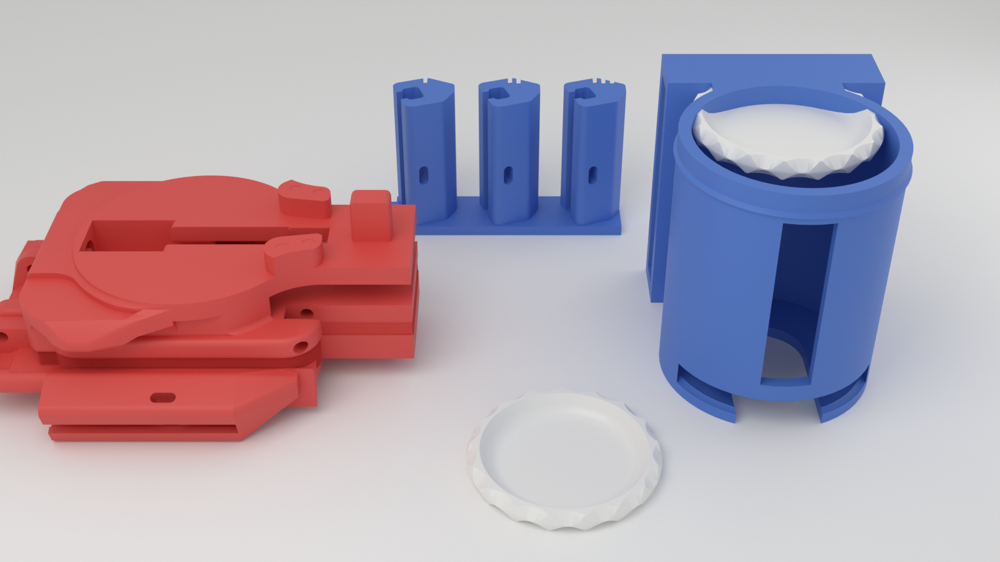
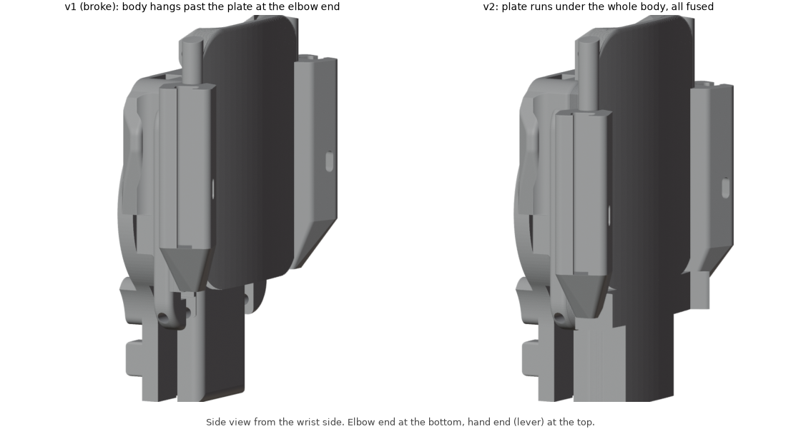
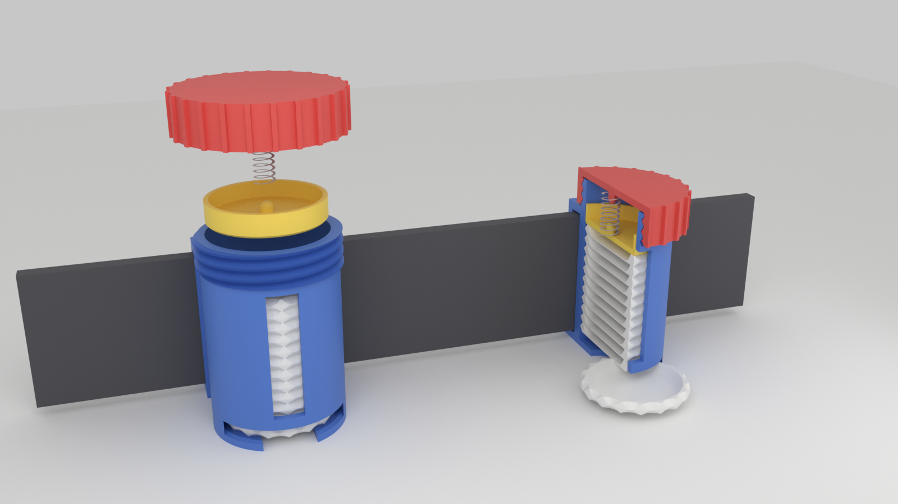

# MK-I disc launcher: watch band one-piece

Fixes and add-ons for MechBrick's Spidey Disc Launcher MK-I (its STLs are named "DWS"). The launcher body and wrist mount become one solid piece that straps on with an Apple Watch band, and there is a belt canister for spare discs. Every part you need is here, laid out on print plates by color.

**v2** (2026-10-30) is below; the first printed version is git tag `mk1-v1`. The 4-disc Mark III version is in [`../mk3/`](../mk3/README.md).



## What was breaking

The original wrist mount is two parts: a top plate (`DWS_WristMount_Body_v4`) and a C-shaped cuff (`DWS_WristMount_Brace_v2`). The cuff's curled ends hook around curled edges on the plate. Those curls are about 2 mm thick at the neck, in short segments, and they take every snap-on, pull-off and shot. That's the torn edge in the photo. The launcher body then pins onto the plate with a filament pin through two small tabs.

## v2: after the Halloween party

v1 snapped at the elbow end, where the launcher body hung 22 mm past the end of the plate with nothing under it and the print layers ran straight across it (photos and the walkthrough video are in `feedback/2026-10-30/`). v2:



- **Truly one piece.** The plate now runs under the whole body, out to the elbow end, and every gap between plate and body is filled, all the way along (v1 only joined the sides). About 5,300 mm3 more material holding it together.
- **Pin end fused.** The plate tabs and body knuckles at the hand end are filled into solid blocks. The pin hole stays open because the trigger link (`Link3`) still pivots on it, and its slot between the knuckles stays clear.
- **Leftover holes filled.** The four small holes by the C-spring base (old mount) are filled flush.
- **Band 5 mm further toward the elbow,** so the launcher sits 5 mm closer to the hand.
- **Lever test prints.** `Link2_Lever_bent_10deg` and `_bent_20deg` swing the palm cap end down toward the palm by 10 and 20 degrees; the pivot holes don't move. Print both, keep the one that sits best.
- **Bigger disc test prints.** The disc sits a little loose, so plate 4 also has three discs at 101% and three at 101.5% (names show the size in the slicer's object list). Try them in the launcher; if one feels right, that's the size to print from now on.
- It also prints a little easier: less overhang (525 vs 612 mm2) and more of it sits on the bed.
- **Belt canister v3: spring dispenser with a screw cap.** Discs load from the top and come out the bottom: a one-disc-high exit slot across the front, a finger slot up through the floor to slide the bottom disc out, and a small ridge at the exit so a disc doesn't slip out while he runs. On top of the stack sits a flat follower (yellow below) with a metal spring above it, held down by a screw cap, so the stack stays flat and feeds down as discs come out. The follower is taller than the exit slot, so it can't come out with the last disc.
  - Spring: the 5.5 x 38 mm one (same size as the MK-I return spring). It pushes until about 4 discs are left, then gravity feeds the rest. A longer spring (5 to 6 mm wide, 45 to 60 mm long) would push all the way down; change `SPRING_L` in `launcher.py` if you get one.



## Print plates

**Open `spidey_launcher_all_plates_kobra3.3mf` as a project** (Anycubic Slicer Next, OrcaSlicer or Bambu Studio). It has all six plates in one file, laid out by filament color. Print them in this order:

| Plate | Color | What's on it |
|---|---|---|
| 1 `plate1_any_color_fit_test` | any | Watch band fit coupon v2 (notch in the base corner): three short rails, 1 / 2 / 3 notches on top = loosest to tightest. **Print this first.** |
| 2 `plate2_red_launcher` | red | **The main print:** launcher body and wrist plate as one part, plus the palm cap (`Link2_Cap`), trigger pad (`Link3_Pad`) and three levers: original, bent 10 and bent 20 degrees. |
| 3 `plate3_black_mechanism` | black | The moving parts: slider and retainer, pushers A and B, `Link3`, spring lock pin, 5 printed springs. |
| 4 `plate4_any_color_discs` | any | 12 discs, enough to fill the canister, plus test discs at 101% and 101.5%. |
| 5 `plate5_black_belt_canister` | black | Belt canister v3, its screw cap and the spring follower (cap in a contrasting color looks good). |
| 6 `optional_plate_only` | either | Just the new wrist plate, if you'd rather keep a separate launcher body and pin it on like before. |

If your slicer puts everything on one plate instead, use the single-plate files in `plates/` (same names). `stl/` has an STL of every part.

Want it the other way around (black launcher, red accents)? Load the other spool; nothing else changes. Hardware, same as the original: one 5.5 x 38 mm metal compression spring and 1.75 mm filament for the pins. The C-shaped printed springs on plate 3 are the launch spring; the original file had 5, likely one plus spares.

The mechanism parts and discs on plates 3 and 4 are the original designer's files, unchanged (copies are in `original/parts/`).

## What the new parts do

- **One-piece launcher:** the launcher body and wrist plate are one part, replacing `Main Body_Short`, `WristMount_Body` and `WristMount_Brace`. No curled hooks, no cuff, and the body can't come off the plate. Each side has a solid rail that takes an Apple Watch band.
- **Band slot:** closed at one end, like the fit coupon. Slide the band in from the open end until it stops and clicks; the latch hole is 11 mm from the stop, so 41 mm and 45 mm bands both catch. Poke a paperclip in the hole to release it.
- **Belt canister:** unscrew the cap, drop up to 12 discs in, then the follower (flat side down, pin up), then the spring over the pin. Screw the cap on; its pin goes into the top of the spring. To get a disc out, put a finger up into the slot in the bottom and slide the bottom disc out the front; the spring pushes the next one down. The window shows how many are left.

### How the one-piece was made

- The launcher body's end knuckles pin between the plate's two tabs (both 2.2 mm holes). Flipped end for end about that pin, the body lies along the plate with zero overlap and a 2.3 mm gap under its floor.
- v2: the gap is filled under the whole body (v1 only did the sides). The only space left open at the pin end is the trigger link's slot between the knuckles.
- The two small windows in the body's floor, where the old cuff hooks clipped in, are filled solid.
- The pin hole is kept open, so anything that pivoted on that pin still can.

## Before printing

1. **Band fit:** print plate 1, push your band all the way down each slot and tug it. Pick the one that slides in and clicks so it won't pull out (poke a paperclip in the side hole to release it). Then set `FIT` in `launcher.py` and rerun:

   | Coupon | 1 notch | 2 notches | 3 notches |
   |---|---|---|---|
   | v1 (no base notch) | -0.15 | 0 | +0.15 |
   | v2 (notch in base corner) | -0.20 | -0.25 | -0.30 |

   Results so far: v1's -0.15 pulled out; **v2's 1-notch slot (-0.20) fits and clicks**, so `FIT` is -0.20. The launcher's rails match the coupon: the slot is closed at one end, so slide the band in from the open end until it stops and clicks.
2. **Assembly order:** with the body fused to the plate, the moving parts have to go in with the body already on the plate. I checked that the body's floor has no openings parts would need to pass through from below, but check your assembly steps against it before printing.
3. **Belt size:** the belt loop is sized for a 38 x 4.5 mm belt (`BELT_W`, `BELT_T` in `launcher.py`). It's loose on his belt since that one was printed smaller; if you want it snug, measure the belt and change those two numbers.

## PETG or PLA

- **Launcher, canister, mechanism parts, discs: PETG.** It bends before it breaks, which is what this toy needs, and it's what your Kobra is already dialed in for. PLA is stiffer but snaps.
- **Launch springs: plain PLA** (not matte or silk). MechBrick recommends that for the launch spring on the Mark III, and the MK-I spring was tuned in PLA too. PETG springs will push softer and shoot shorter.

## Print settings (Anycubic Kobra 3 V2, PETG)

- 0.4 mm nozzle, 0.12 to 0.16 mm layers
- **6 walls**, 5 top/bottom layers, 40% gyroid infill (the rails end up mostly solid)
- **Plate 2:** the launcher prints standing on its end, the way the original body printed (already turned that way in the file). Turn on tree supports, **build plate only**: the free end of the plate and the ends of the rails need a few. A 5 mm brim helps; it's 71 mm tall on a small footprint.
- **Plates 3 and 4:** the original parts in the designer's orientation; use supports if your slicer flags overhangs.
- **Plate 5:** the canister prints upright; turn on supports (build plate only) for the roof of the exit slot at the bottom front. The cap prints top-down as laid out and the follower flat side down; no supports for either.
- Plate 1 and the optional plate: no supports.

## Changing the design

Everything is generated from `launcher.py`; the sizes are settings at the top.

```bash
pip install numpy trimesh manifold3d
python mk1/launcher.py
```

That rebuilds the all-plates 3MF, `plates/` and `stl/`, and fails if any part has loose pieces or hidden pockets. To re-render the picture in Blender:

```bash
blender -b -P mk1/render.py
```

`original/` holds the source files it needs: the original wrist plate, the launcher body, the mechanism parts and a disc (30.46 mm across, 3.2 mm thick).

## Credits

This is a remix of [Spidey Disc Launcher MK-I](https://makerworld.com/en/models/575061-spidey-disc-launcher-mk-i) by MechBrick (its files are the "DWS" STLs in `wrist-mounted-disc-shooter_stls.zip` and `spidey-ammo_stls.zip`). MK-I is itself a remix of uhltimate's 6-Shot Disc Shooter, which the disc and the printed spring come from.

License: MK-I is CC BY-NC-SA (Attribution, NonCommercial, ShareAlike), so this remix uses the same license: credit MechBrick, not for sale.

What changed: the launcher body and wrist mount are fused into one part, the snap-hook cuff is replaced by Apple Watch band rails, and there's a new belt canister and band fit coupon. The mechanism parts and discs are the original files, unchanged.
